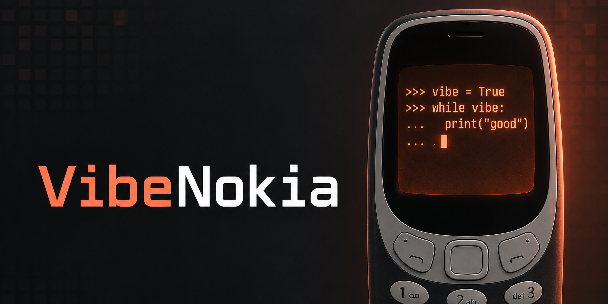
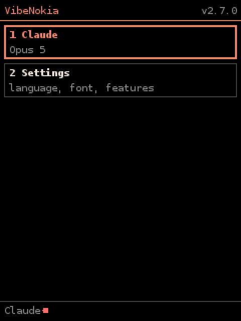
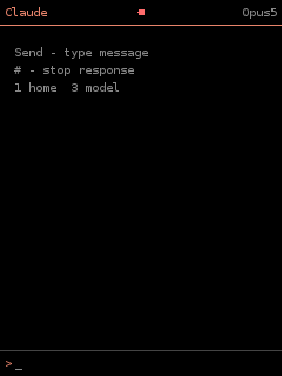
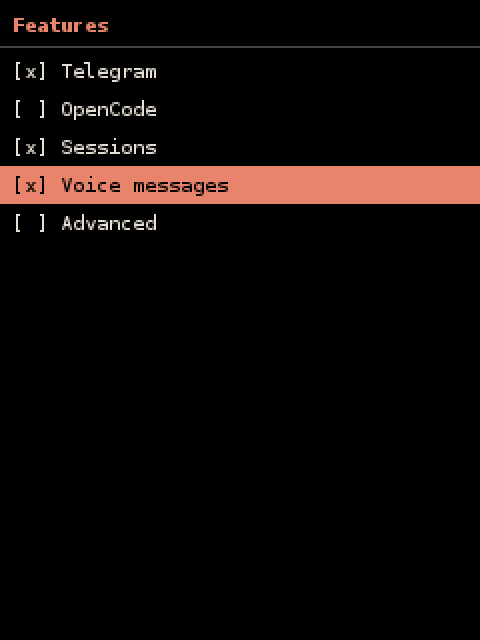
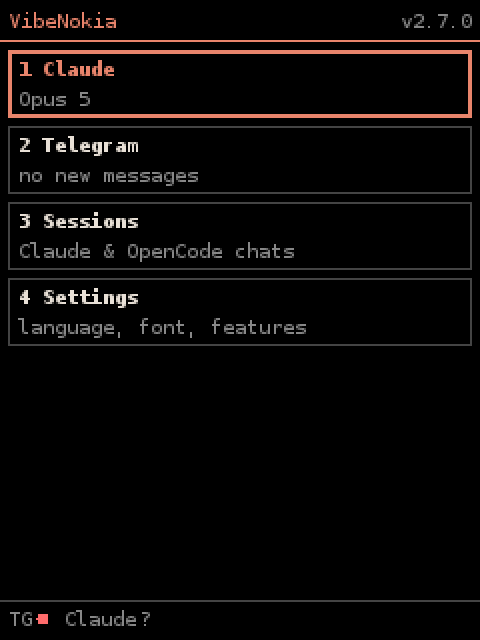
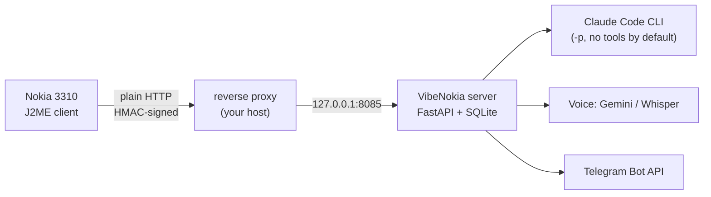

<p align="center">
  
</p>

<h1 align="center">VibeNokia</h1>

<p align="center">
  <b>Vibe-code with Claude from a Nokia 3310.</b><br>
  A tiny J2ME terminal on a 2017 feature phone, a small signed-request server behind it, and 41 mini games for the menu.
</p>

<p align="center">
  
  
  
  
  
  
</p>

<p align="center">
  <a href="#quick-start">Quick start</a> ·
  <a href="#features">Features</a> ·
  <a href="#menu-and-settings">Menu</a> ·
  <a href="#how-it-works">How it works</a> ·
  <a href="#security">Security</a> ·
  <a href="README.ru.md">Русский</a>
</p>

---

## At a glance

| 📟 A real terminal on 240x320 | 🔐 Signed requests, no secrets in the app | 🎮 41 games included |
|---|---|---|
| Chat with Claude, switch sessions and models, send voice messages, read Telegram, all from a 12-key keypad. | The phone is paired once and gets its own key. Every request is HMAC-signed; the key never crosses the network. | Nine written here, 32 MIT-licensed ones from the J2ME Game Archive, each with its own icon. |

```text
you    ▸ why does my build fail on line 42?
claude ▸ reading build.log ...
claude ▸ Missing semicolon after the
         import on line 41. Add ';'.
you    ▸ (holds *, speaks) "and fix the test too"
```

*Illustrative transcript, not a recording.*

## Why

Because the phone is the point. A feature phone has no browser worth using, no app store, and a battery that lasts a week, yet it can open a plain HTTP connection. VibeNokia puts a thin, hand-written Java ME client on it and does everything heavy on a server you control, so you get a pocketable Claude without a smartphone. It is also a compact reference for a hard target: CLDC 1.1, no crypto library (SHA-256/HMAC are written by hand), custom `Canvas` UI, request signing and replay protection over a channel that cannot do TLS.

## Features

| | |
|---|---|
| 💬 **Chat** | Claude sessions with history, rename/delete, model switch (Opus / Sonnet / Haiku) |
| 🎙 **Voice** | Hold `*` to record AMR; the server transcribes it (Gemini via OpenRouter, Groq Whisper fallback) |
| ✈️ **Telegram** | Contacts, text and voice through your own bot, with an unread badge on the home screen |
| 🔑 **Per-device keys** | One-time pairing code, key rotation from the phone, revoke a device from the server |
| 🛡 **Replay-proof** | HMAC-SHA256 over method, path, counter, body hash and host; 64-request sliding window |
| 🧩 **Simple by default** | Opens to two tiles (Claude, Settings); Telegram, voice, sessions and advanced tools are switches in Settings, or capped server-side |
| 📦 **Over-the-air** | Serves its own `.jad/.jar` for install and updates |
| 🎮 **Game catalogue** | 41 standalone MIDlets, no permissions, no network |
| 🌍 **RU / EN** | Interface in both languages |

## Menu and settings

The app opens straight into a **simple menu**: *Claude* (chat) and *Settings*. Everything else is off until you turn it on, so a first-time user sees two tiles, not a cockpit.

<p align="center">
  
  
   Features" width="180">
  
</p>
<p align="center"><sub>Simple menu, chat, Settings &gt; Features, and the menu after enabling Telegram and Sessions. Rendered in MicroEmulator at 240x320.</sub></p>

**On the phone:** Settings > Features is a list of switches (OK toggles a row, *Save* applies it; the choice is kept in the phone's RMS storage).

| Feature | What it adds | Default |
|---|---|---|
| **Telegram** | Telegram tile with unread badge, contacts, text and voice through your bot | off |
| **OpenCode** | Second chat tile with free OpenCode models (server must run with `VIBENOKIA_OPENCODE=1`) | off |
| **Sessions** | Session list: switch, rename, delete; also *Sessions* in the chat menu | off |
| **Voice messages** | Hold `*` in a chat to record; asks for the microphone only when on | off |
| **Advanced** | Servers list, in-app update, key rotation, re-pairing | off |

Always available: chat, model choice (Opus / Sonnet / Haiku), new chat, language, font size.
Tiles are numbered in the order they are shown; press the number to open one, `5`/OK opens the selected, `9` help, `0` about.

**On the server:** `VIBENOKIA_FEATURES=telegram,voice,sessions` in `.env` is a ceiling for every phone. A feature missing from the list is hidden in the app (greyed out in Features) and its API routes answer 404, so a server that never uses Telegram or voice does not expose them. Default: all. The list reaches the phone in the `/ping` reply.

Upgrading from a build that had no Features screen keeps everything that was visible before; a fresh install starts simple.

## Quick start

**Requirements:** Docker with Compose, `make`, and a Claude API key or a Claude Code login. A public host/port the phone can reach for real use (see [deployment](docs/deployment.md)).

```bash
git clone https://github.com/meshoklv/vibenokia && cd vibenokia
./scripts/quickstart.sh                  # creates .env with a fresh key, builds and starts the server on 127.0.0.1:8085
```

Give it Claude access, either way:

```bash
echo 'ANTHROPIC_API_KEY=sk-ant-...' >> .env && docker compose up -d     # API key
docker compose run --rm server claude login                              # or log in once (state kept in ./data/claude-home)
```

Build the phone app (needs Docker; it pulls a public J2ME toolchain image) and the games:

```bash
make -C client SERVER_URL=http://your.host:8080    # -> client/dist/VibeNokia.jar + VibeNokia.jad
./scripts/build-games.sh                           # optional -> games/dist/
```

Install `VibeNokia.jad` on the phone (copy to the memory card, open it in the file manager), open the "VibeNokia" app, press `5` to request a pairing code, then read it on the server:

```bash
docker compose exec server cat /app/data/pair_code.txt
```

Type the 6 digits on the phone. Done; then set `VIBENOKIA_PAIRING=0` in `.env` and `docker compose up -d`.

<details>
<summary>Run without Docker</summary>

Needs Python 3.10+, `ffmpeg` (voice) and the `claude` CLI on `PATH`.

```bash
./scripts/run-local.sh      # binds to 127.0.0.1:8085
```

</details>

> [!NOTE]
> **Tested on:** the client on a physical Nokia 3310 (2017, TA-1030) by the author during development; in this release the client and all 41 games build in the J2ME container (the new menu and Features screens were driven by hand in MicroEmulator, which is where the screenshots come from), the server image builds and answers on loopback (403 without auth), and pairing plus signed chat were exercised end to end with the phone emulator and a stub `claude` binary.
> **Not yet tested on:** a real Claude call inside the published Docker image, other Series 30+/40 handsets, TLS fronts with the phone.

## How it works



The phone cannot do modern TLS, so it speaks plain HTTP and proves who it is with a per-device HMAC signature instead. The server verifies the signature and a request counter, then runs `claude -p` with a short system prompt tuned for a tiny screen, and returns text. Voice goes through ffmpeg to a speech-to-text API; Telegram goes through a bot you create. State (sessions, devices, contacts) lives in one SQLite file under `data/`.

## Configuration

Set in `.env` (see [`.env.example`](.env.example)):

| Variable | Default | Meaning |
|---|---|---|
| `VIBENOKIA_API_KEY` | generated | Admin key; protects OTA and game downloads |
| `VIBENOKIA_HOST` / `VIBENOKIA_PORT` | `127.0.0.1` / `8085` | Listen address (Docker publishes on loopback only) |
| `VIBENOKIA_PAIRING` | `0` in code, `1` in `.env.example` | Allow one-time pairing codes |
| `VIBENOKIA_PUBLIC_HOST` | empty | Only accept signatures made for this `host:port` |
| `ANTHROPIC_API_KEY` | empty | Claude access (or `claude login`) |
| `VIBENOKIA_CLAUDE_ARGS` | empty | Extra Claude flags, e.g. `--allowedTools Read,Grep,Glob` |
| `OPENROUTER_API_KEY`, `GROQ_API_KEY` | empty | Voice transcription |
| `TELEGRAM_BOT_TOKEN`, `VIBENOKIA_OWNER_CHAT` | empty | Telegram bridge; send pairing codes to your chat |
| `VIBENOKIA_OPENCODE` | `0` | Optional second engine, read the warning below |
| `VIBENOKIA_FEATURES` | all | Features phones may enable: `telegram,opencode,sessions,voice,advanced` |

## Security

- The server listens on **loopback only**. Docker publishes `127.0.0.1:8085`. Expose it deliberately through a proxy that forwards only the phone's paths ([deployment](docs/deployment.md)).
- No default passwords. The admin key is generated on first run; devices get their own keys through a one-time code that expires in 10 minutes, is used once, and is never written to the log (it goes to `data/pair_code.txt` with mode 600).
- No network admin API: devices are listed/revoked locally with `tools/devices.py`.
- **No shell by default.** Claude runs with `--permission-mode dontAsk` and no pre-approved tools. If you allow tools via `VIBENOKIA_CLAUDE_ARGS`, a paired phone can make Claude use them, so treat a paired phone like an SSH key and keep the allow-list narrow. The server removes its own secrets from Claude's environment.
- OpenCode (`VIBENOKIA_OPENCODE=1`) is off by default: its agents may run tools per *your* OpenCode configuration.
- ⚠️ The channel is **not encrypted**. Prompts and answers can be read by anyone on the path. Signatures stop forgery, guessing and replay, not eavesdropping.
- `VIBENOKIA_FEATURES` lets you shrink the attack surface: routes of features you list out (Telegram, voice) answer 404 for every phone.
- Voice and Telegram send data to the services you configure (OpenRouter/Groq/Telegram).

## Roadmap

- [ ] Verify a TLS front on newer Series 40/KaiOS-era handsets
- [ ] Optional per-device tool allow-lists
- [ ] Prebuilt `.jar` release assets

## FAQ

**Will it run on my phone?** It targets CLDC 1.1 / MIDP 2.0 and was built for the Nokia 3310 (2017). Other J2ME phones may work; none are verified.

**Where is Telegram / voice / sessions?** Hidden by default. Turn them on in Settings > Features on the phone (and make sure the server allows them: `VIBENOKIA_FEATURES`, see [Menu and settings](#menu-and-settings)).

**Can I skip Claude?** The server needs the `claude` CLI for chat; Telegram and games work without it.

## Contributing

PRs and issues welcome, see [CONTRIBUTING.md](CONTRIBUTING.md). Some internal comments and in-app strings are intentionally bilingual.

## License

MIT, see [LICENSE](LICENSE). Bundled third-party games: [THIRD_PARTY_NOTICES.md](THIRD_PARTY_NOTICES.md).

---

<p align="center">Made by <a href="https://github.com/meshoklv">@meshoklv</a></p>
