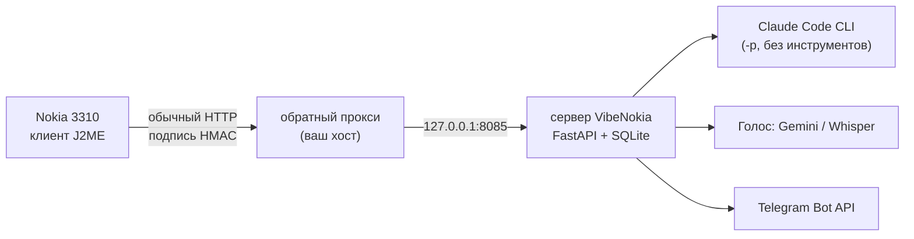

<p align="center">
  
</p>

<h1 align="center">VibeNokia</h1>

<p align="center">
  <b>Вайб-кодинг с Claude прямо с Nokia 3310.</b><br>
  Крошечный J2ME-терминал на кнопочном телефоне 2017 года, маленький сервер с подписанными запросами и 41 мини-игра в меню.
</p>

<p align="center">
  
  
  
  
  
</p>

<p align="center">
  <a href="#быстрый-старт">Быстрый старт</a> ·
  <a href="#возможности">Возможности</a> ·
  <a href="#меню-и-настройки">Меню</a> ·
  <a href="#как-это-устроено">Как устроено</a> ·
  <a href="#безопасность">Безопасность</a> ·
  <a href="README.md">English</a>
</p>

---

## Коротко

| 📟 Настоящий терминал 240x320 | 🔐 Подписанные запросы, секретов в приложении нет | 🎮 41 игра в комплекте |
|---|---|---|
| Чат с Claude, сессии и модели, голосовые, Telegram: всё с 12 кнопок. | Телефон привязывается один раз и получает свой ключ. Каждый запрос подписан HMAC, сам ключ по сети не ходит. | Девять написаны здесь, 32 под MIT из J2ME Game Archive, у каждой своя иконка. |

```text
вы     ▸ почему сборка падает на строке 42?
claude ▸ читаю build.log ...
claude ▸ Нет точки с запятой после
         импорта на строке 41.
вы     ▸ (зажимает *, говорит) "и тест тоже поправь"
```

*Иллюстрация диалога, не запись.*

## Зачем

Весь смысл в телефоне. У кнопочника нет нормального браузера и магазина приложений, зато батарея живёт неделю и он умеет открыть обычное HTTP-соединение. VibeNokia кладёт на него тонкий клиент на Java ME, а всё тяжёлое делает на вашем сервере: карманный Claude без смартфона. Заодно это компактный пример сложной платформы: CLDC 1.1, нет криптобиблиотеки (SHA-256 и HMAC написаны вручную), свой интерфейс на `Canvas`, подпись запросов и защита от повтора там, где нет TLS.

## Возможности

| | |
|---|---|
| 💬 **Чат** | Сессии Claude с историей, переименование и удаление, выбор модели (Opus / Sonnet / Haiku) |
| 🎙 **Голос** | Зажать `*` и говорить; сервер расшифрует (Gemini через OpenRouter, запасной Groq Whisper) |
| ✈️ **Telegram** | Контакты, текст и голосовые через вашего бота, счётчик непрочитанных на главном экране |
| 🔑 **Ключ на устройство** | Одноразовый код привязки, смена ключа с телефона, отзыв устройства на сервере |
| 🛡 **Защита от повтора** | HMAC-SHA256 от метода, пути, счётчика, хэша тела и адреса; окно из 64 запросов |
| 🧩 **Просто по умолчанию** | Открывается с двух плиток (Клод, Настройки); Telegram, голос, сессии и расширенное включаются в Настройках или ограничиваются сервером |
| 📦 **По воздуху** | Сервер сам отдаёт `.jad/.jar` для установки и обновлений |
| 🎮 **Каталог игр** | 41 отдельное приложение без разрешений и без сети |
| 🌍 **RU / EN** | Интерфейс на двух языках |

## Меню и настройки

Приложение открывается сразу в **простое меню**: *Клод* (чат) и *Настройки*. Всё остальное выключено, пока вы не включите, так что новичок видит две плитки, а не пульт самолёта.

<p align="center">
  
  
   Функции" width="180">
  
</p>
<p align="center"><sub>Простое меню, чат, Настройки &gt; Функции и меню после включения Telegram и сессий. Снято в MicroEmulator, 240x320; на скриншотах английский интерфейс (язык переключается в Параметрах).</sub></p>

**На телефоне:** Настройки > Функции: список переключателей (OK переключает строку, *Сохр.* применяет; выбор хранится в RMS телефона).

| Функция | Что добавляет | По умолчанию |
|---|---|---|
| **Telegram** | Плитка Telegram с бейджем непрочитанных, контакты, текст и голос через вашего бота | выкл. |
| **OpenCode** | Вторая плитка чата с бесплатными моделями OpenCode (на сервере нужен `VIBENOKIA_OPENCODE=1`) | выкл. |
| **Сессии** | Список сессий: переключить, переименовать, удалить; пункт «Сессии» в меню чата | выкл. |
| **Голосовые** | Зажмите `*` в чате для записи; микрофон запрашивается только когда включено | выкл. |
| **Расширенное** | Список серверов, обновление из приложения, смена ключа, повторная привязка | выкл. |

Всегда доступно: чат, выбор модели (Opus / Sonnet / Haiku), новый чат, язык, размер шрифта.
Плитки нумеруются в порядке показа: цифра открывает плитку, `5`/OK открывает выбранную, `9` помощь, `0` о программе.

**На сервере:** `VIBENOKIA_FEATURES=telegram,voice,sessions` в `.env` задаёт потолок для всех телефонов. Функция, которой нет в списке, скрыта в приложении (в «Функциях» помечена «выкл. на сервере»), а её API-пути отвечают 404: сервер, которому Telegram или голос не нужны, их не выставляет. По умолчанию включено всё. Список приходит на телефон в ответе `/ping`.

При обновлении с версии без экрана «Функции» остаётся всё, что было видно раньше; чистая установка начинается с простого меню.

## Быстрый старт

**Нужно:** Docker с Compose, `make`, ключ Claude API или вход в Claude Code. Для реального использования публичный адрес и порт, до которого дотянется телефон (см. [развёртывание](docs/deployment.md)).

```bash
git clone https://github.com/meshoklv/vibenokia && cd vibenokia
./scripts/quickstart.sh                  # создаст .env со свежим ключом, соберёт и запустит сервер на 127.0.0.1:8085
```

Доступ к Claude, любым способом:

```bash
echo 'ANTHROPIC_API_KEY=sk-ant-...' >> .env && docker compose up -d     # ключ API
docker compose run --rm server claude login                              # или один раз войти (состояние в ./data/claude-home)
```

Собрать приложение для телефона (нужен Docker, подтянется публичный образ с J2ME) и игры:

```bash
make -C client SERVER_URL=http://your.host:8080    # -> client/dist/VibeNokia.jar + VibeNokia.jad
./scripts/build-games.sh                           # по желанию -> games/dist/
```

Поставьте `VibeNokia.jad` на телефон (скопировать на карту памяти и открыть в диспетчере файлов), запустите «VibeNokia», нажмите `5`, чтобы запросить код привязки, и прочитайте его на сервере:

```bash
docker compose exec server cat /app/data/pair_code.txt
```

Введите 6 цифр на телефоне. Готово; затем поставьте `VIBENOKIA_PAIRING=0` в `.env` и `docker compose up -d`.

<details>
<summary>Запуск без Docker</summary>

Нужны Python 3.10+, `ffmpeg` (для голоса) и `claude` в `PATH`.

```bash
./scripts/run-local.sh      # слушает 127.0.0.1:8085
```

</details>

> [!NOTE]
> **Проверено:** клиент на настоящей Nokia 3310 (2017, TA-1030) автором при разработке; в этом релизе клиент и все 41 игра собираются в J2ME-контейнере (новые меню и экран «Функции» прогнаны вручную в MicroEmulator, оттуда же скриншоты), образ сервера собирается и отвечает на loopback (403 без авторизации), привязка и подписанный чат прогнаны целиком эмулятором телефона и заглушкой вместо `claude`.
> **Пока не проверено:** реальный вызов Claude внутри опубликованного Docker-образа, другие телефоны Series 30+/40, TLS-фронт с телефоном.

## Как это устроено



Телефон не умеет современный TLS, поэтому говорит по обычному HTTP и доказывает, кто он, подписью HMAC своим ключом. Сервер проверяет подпись и счётчик запросов, запускает `claude -p` с коротким системным промптом под маленький экран и возвращает текст. Голос проходит через ffmpeg в сервис распознавания; Telegram идёт через бота, которого вы создаёте сами. Всё состояние (сессии, устройства, контакты) лежит в одном файле SQLite в `data/`.

## Настройка

Задаётся в `.env` (см. [`.env.example`](.env.example)):

| Переменная | По умолчанию | Смысл |
|---|---|---|
| `VIBENOKIA_API_KEY` | генерируется | Админ-ключ, защищает скачивание приложения и игр |
| `VIBENOKIA_HOST` / `VIBENOKIA_PORT` | `127.0.0.1` / `8085` | Адрес прослушивания (Docker публикует только на loopback) |
| `VIBENOKIA_PAIRING` | `0` в коде, `1` в `.env.example` | Разрешить одноразовые коды привязки |
| `VIBENOKIA_PUBLIC_HOST` | пусто | Принимать подписи только для этого `host:port` |
| `ANTHROPIC_API_KEY` | пусто | Доступ к Claude (или `claude login`) |
| `VIBENOKIA_CLAUDE_ARGS` | пусто | Доп. флаги Claude, например `--allowedTools Read,Grep,Glob` |
| `OPENROUTER_API_KEY`, `GROQ_API_KEY` | пусто | Расшифровка голоса |
| `TELEGRAM_BOT_TOKEN`, `VIBENOKIA_OWNER_CHAT` | пусто | Мост в Telegram; код привязки в ваш чат |
| `VIBENOKIA_OPENCODE` | `0` | Второй движок по желанию, см. предупреждение ниже |
| `VIBENOKIA_FEATURES` | все | Функции, которые телефон может включить: `telegram,opencode,sessions,voice,advanced` |

## Безопасность

- Сервер слушает **только loopback**. Docker публикует `127.0.0.1:8085`. Выводить наружу нужно осознанно, через прокси, который пропускает лишь пути телефона ([развёртывание](docs/deployment.md)).
- Паролей по умолчанию нет. Админ-ключ создаётся при первом запуске; устройство получает свой ключ по одноразовому коду, который живёт 10 минут, тратится один раз и в журнал не пишется (лежит в `data/pair_code.txt` с правами 600).
- Сетевой админки нет: устройства смотрят и отзывают локально через `tools/devices.py`.
- **Шелла по умолчанию нет.** Claude запускается с `--permission-mode dontAsk` и без заранее разрешённых инструментов. Если разрешить инструменты через `VIBENOKIA_CLAUDE_ARGS`, привязанный телефон сможет ими пользоваться: относитесь к нему как к SSH-ключу и держите список узким. Свои секреты сервер из окружения Claude убирает.
- OpenCode (`VIBENOKIA_OPENCODE=1`) выключен: его агенты могут запускать инструменты по *вашей* конфигурации OpenCode.
- ⚠️ Канал **не шифруется**. Запросы и ответы может прочитать любой на пути. Подпись защищает от подделки, подбора и повтора, но не от подслушивания.
- `VIBENOKIA_FEATURES` сужает поверхность атаки: пути функций, которых нет в списке (Telegram, голос), отвечают 404 для любого телефона.
- Голос и Telegram отправляют данные в сервисы, которые вы настроили (OpenRouter, Groq, Telegram).

## Планы

- [ ] Проверить TLS-фронт на более новых телефонах
- [ ] Списки разрешённых инструментов на устройство
- [ ] Готовые `.jar` в релизах

## Частые вопросы

**Заработает ли на моём телефоне?** Цель: CLDC 1.1 / MIDP 2.0, собрано под Nokia 3310 (2017). Другие J2ME-телефоны могут работать, но не проверялись.

**Где Telegram / голос / сессии?** По умолчанию скрыты. Включите в Настройки > Функции на телефоне (и проверьте, что сервер их разрешает: `VIBENOKIA_FEATURES`, см. [Меню и настройки](#меню-и-настройки)).

**Можно без Claude?** Для чата серверу нужен `claude`; Telegram и игры работают и без него.

## Участие

Приветствуются PR и issue, см. [CONTRIBUTING.md](CONTRIBUTING.md).

## Лицензия

MIT, см. [LICENSE](LICENSE). Сторонние игры: [THIRD_PARTY_NOTICES.md](THIRD_PARTY_NOTICES.md).

---

<p align="center">Сделал <a href="https://github.com/meshoklv">@meshoklv</a></p>
